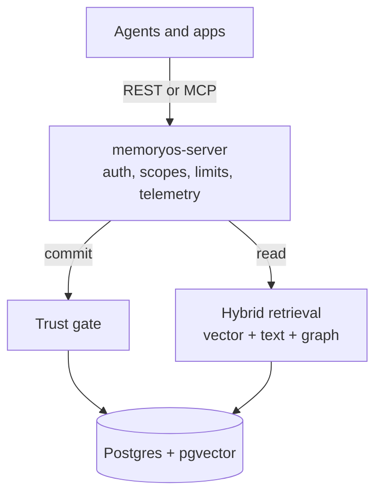
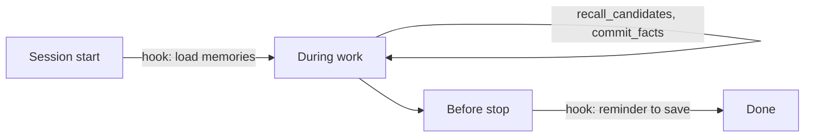

<div align="center">

# 🧠 MemoryOS

**Long-term memory for AI agents that stays current, traceable and hard to poison.**


[Why MemoryOS](#-why-memoryos) · [Quickstart](#-quickstart) · [How it works](#-how-it-works) · [Security](#-security) · [Agent hooks](#-agent-hooks) · [Roadmap](#-roadmap) · [Docs](#-documentation)

</div>

> [!NOTE]
> **Pre-release.** The server, REST API, MCP endpoint and Rust SDK run, and `memoryos setup` is tested
> end to end on macOS with Docker Desktop. It has not been run on Linux or Windows. No model has yet
> used these tools in a real agent session, so what an agent actually remembers is untested. The
> release targets below are goals, not results. Track the work in [`docs/PROGRESS.md`](docs/PROGRESS.md).

## ✨ Why MemoryOS

Most agent memory stops at "store text, search it later". Real memory also has to handle facts that
change and sources that lie.

| Capability | What you get |
|---|---|
| 👤 **Personal memory** | Facts scoped per user, reconciled so new information adds to, replaces or repeats what is known |
| 🕰️ **Memory over time** | A replaced fact is closed, not deleted, so you can ask what is true now or what was true then |
| ✍️ **Self-editing agents** | Size-limited, versioned blocks that agents edit through tools, with conflict detection |
| 🕸️ **Shared knowledge graph** | Every fact is also an edge between entities, shared across agents through scoped access |
| 🛡️ **Poisoning defense** | Low-trust content is quarantined, and every fact traces back to its source |

## 🚀 Quickstart

Needs Docker running, and nothing else: no API key, no `.env`, no provider account. The agent's own
model decides what to remember, and embeddings run locally in the container.

```bash
cargo install --path crates/server
cd your-project
memoryos setup --agent claude-code   # or: opencode, pi
```

The first run builds the image, which takes several minutes, and downloads a 481 MB embedding model,
about 2.5 minutes on a fast connection and much longer on a slow one. Later runs start in seconds and
keep your data and keys.

`setup` starts Postgres and the server through Compose, creates two keys, and connects the agent over
`memoryos mcp`, a local stdio proxy. Agent configuration holds no key and no reference to one.

| | |
|---|---|
| 📁 **Where things live** | `~/.config/memoryos`: `credentials.json` (mode 0600), the database and the generated password |
| 🔑 **Agent key** | Used by hooks and MCP. Scopes `agent:*`, `user:*`, `shared:*`, not an admin |
| 🛡️ **Admin key** | Used only by `memoryos quarantine` |
| 🎯 **Scope** | The current project by default, or `--global` for Claude Code and OpenCode |
| 🧹 **Removing it** | `memoryos setup --uninstall` keeps your data. Add `--delete-data` to erase it |

> [!WARNING]
> Both keys are in one file your user account can read. This stops an injected agent approving its own
> facts through MCP, but an agent with shell access can read that file or run `memoryos quarantine`.

Review what agents wrote outside their own scope:

```bash
memoryos quarantine list --scope user:alice
memoryos quarantine approve <fact-id>
```

Backups, upgrades and incidents are in the [runbook](docs/runbook.md), which still describes the manual
Compose install.

## ⚙️ How it works



Everything reads from **one data model**, so text search, vector search and the graph cannot
disagree:

- **Episodes:** immutable raw input, the source of everything else.
- **Entities:** the people, places and things that facts connect.
- **Facts:** statements with two timelines, when they were true and when we learned them.
- **Blocks:** versioned working notes that an agent edits directly.

## 🛡️ Security

Research shows a poisoned memory survives across sessions, unlike ordinary prompt injection. So:

| Source | What happens to its facts |
|---|---|
| `external` content, such as web pages and documents | Quarantined until approved |
| `agent` writes to user or shared memory | Quarantined until approved |
| `agent` writes to its own scope | Active |
| Lower-trust statement contradicting higher-trust fact | Quarantined, and the original stays in place |
| `user` or `system` statements otherwise | Active |

- **Tenant isolation:** Postgres row-level security enforces it, so a missed filter in the code
  cannot leak another tenant's data.
- **Purging:** removing one bad source deletes what was derived only from it and restores any fact
  it had replaced.
- **Audit trail:** approvals, rejections, retractions and purges are all recorded.

## 🪝 Agent hooks

The agent reads and saves memories through MCP tools. Hooks only load memories and remind the agent to
save, and they cannot bypass validation or quarantine. `memoryos setup` installs them for you.



Without hooks, memory still works, but saving depends on the agent choosing to do it. A hook may
not run if the agent crashes or is killed, so agents should also save during work.

<details>
<summary><b>Claude Code setup</b></summary>

`.claude/settings.json`:

```json
{
  "hooks": {
    "SessionStart": [
      {
        "matcher": "startup|resume|compact",
        "hooks": [{ "type": "command", "command": "memoryos hook session-start" }]
      }
    ],
    "Stop": [
      {
        "hooks": [{ "type": "command", "command": "memoryos hook stop" }]
      }
    ]
  }
}
```

When a save is due, `memoryos hook stop` prints:

```json
{
  "decision": "block",
  "reason": "Before stopping, call commit_facts for durable facts learned in this session. If there are none, stop."
}
```

`Stop` fires at the end of every turn, so the command limits itself to once every 10 turns per
session. `SessionEnd` cannot be used for this, because it has no decision control and cannot make the
agent act.

</details>

<details>
<summary><b>OpenCode setup</b></summary>

`.opencode/plugins/memoryos.ts` and an `mcp.memoryos` entry in `opencode.json`. The plugin adds recalled
memories to compaction. It does not remind the agent to save, which would need a separate handler.

</details>

<details>
<summary><b>Pi setup</b></summary>

`.pi/mcp.json` in the project, plus a short block in `AGENTS.md` that says when to recall and save. Pi
has no hooks here. Pi reads the project file only in a trusted project, so run `/trust` in Pi once.
Project scope only: `setup` does not touch `~/.pi/agent/mcp.json`.

</details>

<details>
<summary><b>Agent configuration only</b></summary>

For a server you already run. Set `MEMORYOS_URL` and `MEMORYOS_API_KEY`, which override the stored
credentials for every command:

```bash
memoryos hook install --agent claude-code   # or: opencode, pi
memoryos hook uninstall --agent claude-code
```

</details>

The `memoryos hook` commands never fail the host: on an error they log to stderr and exit 0.

| Agent | Checked against the real program, with no model turn |
|---|---|
| OpenCode 2.2.5 | The plugin loads, and MCP connects through `memoryos mcp` with 6 tools |
| Pi 1.4.0 | `pi mcp list` connects through `memoryos mcp` with 6 tools, in a trusted project |
| Claude Code | Not run. Only the written files and the proxy are tested |

Untested in all three: a model actually calling the tools, the OpenCode compaction hook firing, and
Pi following its `AGENTS.md` block.

References:
[Claude Code hooks](https://code.claude.com/docs/en/hooks),
[OpenCode plugins](https://opencode.ai/v2/docs/build/plugins/).

## 🗺️ Roadmap

- [x] **Wave 0:** specification, core contracts, database schema, API contract
- [x] **Wave 1:** Postgres store, LLM and embedding clients, eval harness
- [x] **Wave 2:** ingest and worker, hybrid retrieval, agent runtime
- [ ] **Wave 3:** server, MCP, SDK, deployment
- [ ] **Wave 4:** integration, load test, restore drill, independent review

### Release targets

These are goals, not measured results:

| Gate | Target |
|---|---|
| ⚡ Recall latency | p95 under 200 ms at 1M facts, excluding embedding and LLM calls |
| 🕰️ Staleness | At least 95% of replaced facts absent from current recall |
| 🛡️ Poisoning | 0 poisoned facts in recall without approval |
| 🔒 Isolation | 0 cross-tenant reads |
| ♻️ Recovery | Jobs from a killed worker complete after the lease expires |

## 📚 Documentation

| Document | Contents |
|---|---|
| [`docs/runbook.md`](docs/runbook.md) | Install, upgrades, backup and restore, keys, monitoring, incidents |
| [`docs/SPEC.md`](docs/SPEC.md) | Behavior and contracts |
| [`docs/PLAN.md`](docs/PLAN.md) | Development waves and ownership |
| [`docs/PROGRESS.md`](docs/PROGRESS.md) | Status, with proof for each task |
| [`docs/openapi.yaml`](docs/openapi.yaml) | REST API contract |
| [`docs/adr/`](docs/adr/) | Architecture decisions |

## 🧪 Development

Requires Rust 1.92+ and Docker. Integration tests start real Postgres and WireMock containers. Do not
use `cargo test --all-features`, which downloads the embedding model. The test feature list is in
[`.github/workflows/ci.yml`](.github/workflows/ci.yml).

```bash
cargo fmt --all --check
cargo clippy --workspace --all-targets --all-features -- -D warnings
cargo test --workspace --features memoryos-store/integration,memoryos-llm/integration,memoryos-ingest/integration,memoryos-retrieve/integration,memoryos-agent/integration,memoryos-eval/integration,memoryos-server/integration
cargo deny check
```

## 📄 License

Apache-2.0, as declared in `Cargo.toml`.
