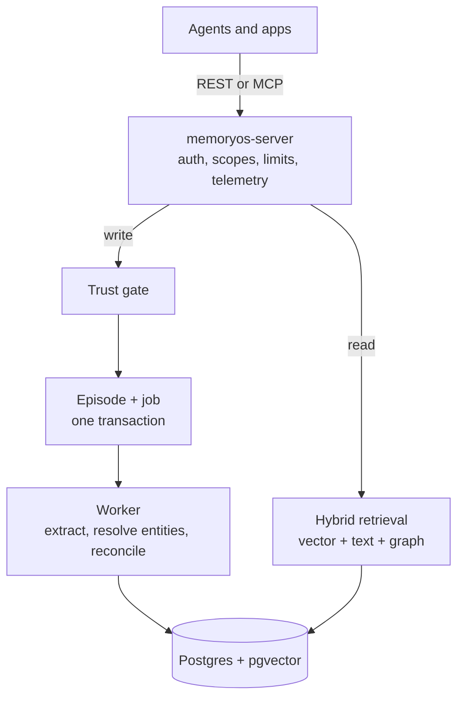
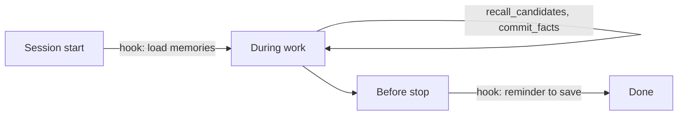

<div align="center">

# 🧠 MemoryOS

**Long-term memory for AI agents that stays current, traceable and hard to poison.**


[Why MemoryOS](#-why-memoryos) · [How it works](#-how-it-works) · [Security](#-security) · [Agent hooks](#-agent-hooks-proposed) · [Roadmap](#-roadmap) · [Docs](#-documentation)

</div>

> [!WARNING]
> **Not usable yet.** The storage layer, LLM clients and eval harness are built, but the server is
> not. Code samples show the planned interface and may change. Track the work in
> [`docs/PROGRESS.md`](docs/PROGRESS.md).

## ✨ Why MemoryOS

Most agent memory stops at "store text, search it later". Real memory also has to handle facts that
change and sources that lie.

| Capability | What you get |
|---|---|
| 👤 **Personal memory** | Facts scoped per user, reconciled so new information adds to, replaces or repeats what is known |
| 🕰️ **Memory over time** | A replaced fact is closed, not deleted, so you can ask what is true now or what was true then |
| ✍️ **Self-editing agents** | Size-limited, versioned blocks that agents edit through tools, with conflict detection |
| 🕸️ **Shared knowledge graph** | Every fact is also an edge between entities, shared across agents through scoped access |
| 🛡️ **Poisoning defense** | Low-trust content is quarantined, and every fact traces back to its source |

## 🔍 Example

The user says *"I moved to Bandung"* after previously living in Jakarta:

```rust
let mem = MemoryOs::connect(url, api_key).await?;
let user = Scope::user("u_123");

mem.remember(user.clone(), Episode::message("I moved to Bandung")).await?;

// Current answer: Bandung
let now = mem.recall(user.clone(), "where does the user live?").await?;

// Answer as of January 2025: Jakarta
let then = mem.recall(user, "where does the user live?")
    .as_of(date(2025, 1, 1))
    .await?;
```

## ⚙️ How it works



Everything reads from **one data model**, so text search, vector search and the graph cannot
disagree:

- **Episodes:** immutable raw input, the source of everything else.
- **Entities:** the people, places and things that facts connect.
- **Facts:** statements with two timelines, when they were true and when we learned them.
- **Blocks:** versioned working notes that an agent edits directly.

### Two ways to run

| | 🖥️ Host mode (proposed) | ☁️ Worker mode |
|---|---|---|
| **Who extracts facts** | The coding agent's own model | A background worker calling an LLM API |
| **API key needed** | None | OpenAI, or Anthropic plus OpenAI |
| **Embeddings** | Local model in the binary | OpenAI |
| **Runs when the agent is closed** | No | Yes |
| **Best for** | Claude Code, OpenCode and similar agents | Servers and multi-user apps |

## 🛡️ Security

Research shows a poisoned memory survives across sessions, unlike ordinary prompt injection. So:

| Source | What happens to its facts |
|---|---|
| `external` content, such as web pages and documents | Quarantined until approved |
| `agent` writes to user or shared memory | Quarantined until approved |
| `agent` writes to its own scope | Active |
| Lower-trust statement contradicting higher-trust fact | Quarantined, and the original stays in place |
| `user` or `system` statements otherwise | Active |

- **Tenant isolation:** Postgres row-level security enforces it, so a missed filter in the code
  cannot leak another tenant's data.
- **Purging:** removing one bad source deletes what was derived only from it and restores any fact
  it had replaced.
- **Audit trail:** approvals, rejections, retractions and purges are all recorded.

## 🪝 Agent hooks (proposed)

In host mode, the agent reads and saves memories through MCP tools. Hooks are optional. They only
load memories and remind the agent to save, and they cannot bypass validation or quarantine.



Without hooks, memory still works, but saving depends on the agent choosing to do it. A hook may
not run if the agent crashes or is killed, so agents should also save during work.

<details>
<summary><b>Claude Code setup</b></summary>

`.claude/settings.json`:

```json
{
  "hooks": {
    "SessionStart": [
      {
        "matcher": "startup|resume|compact",
        "hooks": [{ "type": "command", "command": "memoryos hook session-start" }]
      }
    ],
    "Stop": [
      {
        "hooks": [{ "type": "command", "command": "memoryos hook stop" }]
      }
    ]
  }
}
```

When a save is due, `memoryos hook stop` prints:

```json
{
  "decision": "block",
  "reason": "Before stopping, call commit_facts for durable facts learned in this session. If there are none, stop."
}
```

`Stop` fires at the end of every turn, so the command limits itself, for example to once every 10
turns. `SessionEnd` cannot be used for this, because it has no decision control and cannot make the
agent act.

</details>

<details>
<summary><b>OpenCode setup</b></summary>

`.opencode/plugins/memoryos.ts` (v1 plugin API):

```ts
export const MemoryOS = async ({ $ }) => ({
  "experimental.session.compacting": async (_input, output) => {
    const memories = await $`memoryos hook session-start`.text();
    output.context.push(memories);
  },
});
```

This keeps memories through compaction but does not remind the agent to save, which needs a separate
`session.idle` handler. OpenCode v2 renames this hook to `ctx.session.hook("compaction", ...)`.

</details>

<details>
<summary><b>One-command install (planned)</b></summary>

Adds its entries and keeps your existing hooks:

```bash
memoryos hook install --agent claude-code
memoryos hook install --agent opencode
```

</details>

These setups are untested, and the `memoryos hook` commands are not built yet. References:
[Claude Code hooks](https://code.claude.com/docs/en/hooks),
[OpenCode plugins](https://opencode.ai/docs/plugins/),
[OpenCode v1 migration](https://opencode.ai/v2/docs/build/plugins/migrate-v1/).

## 🗺️ Roadmap

- [x] **Wave 0:** specification, core contracts, database schema, API contract
- [x] **Wave 1:** Postgres store, LLM and embedding clients, eval harness
- [ ] **Wave 2:** ingest and worker, hybrid retrieval, agent runtime
- [ ] **Wave 3:** server, MCP, SDK, deployment
- [ ] **Wave 4:** integration, load test, restore drill, independent review

### Release targets

These are goals, not measured results:

| Gate | Target |
|---|---|
| ⚡ Recall latency | p95 under 200 ms at 1M facts, excluding embedding and LLM calls |
| 🕰️ Staleness | At least 95% of replaced facts absent from current recall |
| 🛡️ Poisoning | 0 poisoned facts in recall without approval |
| 🔒 Isolation | 0 cross-tenant reads |
| ♻️ Recovery | Jobs from a killed worker complete after the lease expires |

## 📚 Documentation

| Document | Contents |
|---|---|
| [`docs/SPEC.md`](docs/SPEC.md) | Behavior and contracts |
| [`docs/PLAN.md`](docs/PLAN.md) | Development waves and ownership |
| [`docs/PROGRESS.md`](docs/PROGRESS.md) | Status, with proof for each task |
| [`docs/openapi.yaml`](docs/openapi.yaml) | REST API contract |
| [`docs/adr/`](docs/adr/) | Architecture decisions |

## 🧪 Development

Requires Rust 1.85+ and Docker. Integration tests start real Postgres and WireMock containers.

```bash
cargo fmt --all --check
cargo clippy --workspace --all-targets --all-features -- -D warnings
cargo test --workspace --all-features
```

## 📄 License

Apache-2.0, as declared in `Cargo.toml`.
